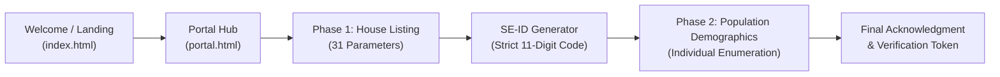

# Census 2027: Digital Enumeration & Civic Portal

[](https://census-2027-ten.vercel.app)
[](https://census-2027-ten.vercel.app)
[](https://census-2027-ten.vercel.app)

> **Office of the Registrar General & Census Commissioner, India**  
> *Ministry of Home Affairs, Government of India*  
> **Live Application:** [https://census-2027-ten.vercel.app](https://census-2027-ten.vercel.app)  
> **Repository:** [https://github.com/harshitraj0073-star/CENSUS-2027](https://github.com/harshitraj0073-star/CENSUS-2027)

A full-fledged, web-based digital enumeration and public awareness portal for the upcoming **Census 2027** initiative. Engineered with accessible semantic HTML, high-contrast civic UI, multi-phase verification pipelines, an interactive GIS map repository, and an automated 11-digit SE-ID (Self-Enumeration ID) state machine.

---

## 🏛️ System Architecture & Workflow



### 1. Multi-Phase Enumeration Pipeline
- **Phase 1: House Listing & Housing Census (`phase1.html`)**
  - Captures 31 structured housing and amenability parameters (building material, drinking water source, lighting, latrine availability, digital connectivity).
  - Enforces client-side validation for mobile numbers and mandatory fields.
- **Strict 11-Digit SE-ID State Engine (`js/app.js`)**
  - Upon Phase 1 submission, generates a cryptographically random, official-format **11-digit Self-Enumeration ID** prefixed with `27` (e.g. `27849201948`).
  - Automatically caches the SE-ID in browser `localStorage` and unlocks access to Phase 2.
- **Phase 2: Population Enumeration (`phase2.html`)**
  - Collects individual demographic, educational, occupation, and migration data.
  - Links demographic entries directly to the verified household SE-ID.

### 2. Interactive Civic Modules
- **Census GIS Module:** Interactive boundary mapping powered by embedded Google Maps spatial data for researchers and administrators.
- **Population Finder Modal:** Instant macro telemetry for all-India households, population distribution, and gender metrics.
- **Floating AI Guide:** Real-time query assistant answering questions on documentation requirements, phase duration, and SE-ID recovery.

### 3. Accessibility & Civic Design
- Screen-reader friendly skip navigation links (`.sr-only`).
- Semantic landmarks (`<main>`, `<header>`, `role="banner"`, `aria-label`).
- Multilingual accessibility switcher supporting 13 scheduled Indian languages.

---

## 🌐 Live Experience

Visit the deployed portal directly in your browser:  
👉 **[https://census-2027-ten.vercel.app](https://census-2027-ten.vercel.app)**

```bash
# To run locally with any static HTTP server:
python3 -m http.server 8000
# Then visit http://localhost:8000 in your browser
```

---

## 📁 Repository Structure

```text
CENSUS-2027/
├── index.html        # Entry landing page
├── portal.html       # Main enumeration portal dashboard & GIS modals
├── info.html         # Citizen information and statutory guidelines
├── phase1.html       # House listing & housing census module (31 fields)
├── phase2.html       # Population enumeration module & final token
├── css/
│   └── style.css     # Clean responsive design system (Gov of India theme)
├── js/
│   ├── api.js        # Secure backend proxy interface client
│   └── app.js        # Core interaction logic, SE-ID generator, & AI chatbot
└── tests/
    └── form-validation.test.js  # Form validation test suite
```

---

## 🛠️ Tech Stack

- **Frontend Core:** Semantic HTML5, CSS3 Glassmorphism & Government Theme, Vanilla ES6+ JavaScript.
- **Spatial & Media:** Embedded Google Maps GIS Module.
- **Testing:** Automated form validation test suite.
- **Hosting:** Vercel Edge Serverless Deployment.

---

## 👨‍💻 Author

**Harshit Raj**  
B.Tech Computer Science & Engineering, Ajeenkya DY Patil University (ADYPU), Pune  
GitHub: [@harshitraj0073-star](https://github.com/harshitraj0073-star)
